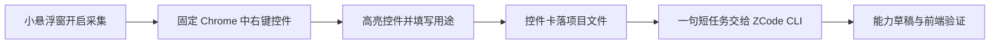

> 本文保留移植前方案说明；历史首版实测不等于新独立仓库的 GUI 或 ZCode 对话接入已验收。当前入口以 [项目说明](../README.md) 为准。

# CDP 控件采集与能力收束

核对日期：2026-11-26。现已提供可运行的 Windows 首版，源码和使用说明见 [CDP 控件采集器](../README.md)。普通主页面采集、固定资料浏览器启动与复用已做隔离验证；未在用户真实业务网站执行任务。

## 要完成的事情

在置顶的小悬浮窗中选定**已经登录的专用 Google Chrome 和目标标签页**，开启采集模式。人在网页上右键一个控件，控件附近出现说明框，填写它的用途。保存一张控件卡，之后通过独立技能把相关卡片交给 ZCode 或其他 Agent，整理成项目里的页面约定、skill 和可执行的前端操作。

建议的主线：

悬浮窗负责连接、开关和保存提示；网页内的小浮层负责就地填写说明。详细记录保存在项目文件，运行日志按需在外部打开，模型连接由独立 Agent 和技能处理。悬浮窗没有模型任务面板，也不启动 ZCode 进程。

## CDP 现在有哪些调用入口

CDP 是浏览器调试协议。当前既可以直接写程序连接，也已有适合 Agent 使用的官方命令行工具。

| 入口 | 用途 | 本方案中的位置 |
|---|---|---|
| Chrome DevTools CLI | Chrome 官方提供的 shell 调用入口，与其 MCP 工具共用持久后台引擎 | 给 Agent 或脚本读取页面快照、定位、输入、点击和检查 |
| Playwright CLI | Microsoft 的浏览器自动化命令行，支持附加现有 CDP 端点 | 适合通过终端接入固定浏览器并执行页面步骤 |
| Chrome DevTools MCP | 将浏览器操作暴露成 Agent 工具调用 | 所用 Agent 已支持 MCP 时可选；不是普通的一次性 shell 命令 |
| 直接 CDP / Playwright 库 | 桌面应用内维护连接、接收事件、注入采集浮层 | 更适合实现持续运行的右键采集模式 |

Chrome 官方 CLI 的程序名是 `chrome-devtools`。当前源码提供通过 `--browserUrl` 指定已有 CDP 端点的启动参数；初始化后读取 `list_pages`、`take_snapshot` 等。不要每次动作都重新启动 daemon，也不要把默认新开浏览器当成复用已有身份。[官方 CLI 介绍](https://developer.chrome.com/docs/devtools/agents/cli)、[当前 CLI 源码](https://github.com/ChromeDevTools/chrome-devtools-mcp/blob/main/src/daemon/chrome-devtools-cli.ts)。

Playwright 官方文档明确支持 `playwright-cli attach --cdp=http://127.0.0.1:9222`，并提供 `detach` 退出附加会话、保留外部浏览器。具体版本的参数以该版本帮助为准。[官方 attach / detach 文档](https://playwright.dev/agent-cli/commands/attach)。

这些工具提供“执行入口”。用户右键后填写“这个控件是什么功能”、再将多个控件合成业务能力的体验，需要在其上构建采集与语义记录层；不能把普通浏览器 CLI 宣称为已经具备这套产品流程。

## 右键后实际收集什么

位置数据和功能说明分别保存。建议的结构示例见 [control-card.example.json](../examples/control-card.example.json)。

| 内容 | 实际意义 |
|---|---|
| 页面 URL 的 origin / path、标题、目标页签身份 | 确定控件属于哪个网站与页面，避免串页 |
| frame 路径与页面区域 | 确定控件位于主文档、哪个 iframe 或哪个业务区域 |
| 标签、计算后的 role / 可访问名称、label 与稳定属性 | 解释控件的结构身份；可以从 DOM 与可访问性信息组合获取 |
| 一组候选定位规则及其匹配数 | 为以后重新定位提供依据，不只保存一个长 CSS 路径 |
| 所属业务对象，例如订单号对应的行 | 区分页面上多个同名“详情”按钮 |
| 人填写的名称、用途、允许动作 | 说明这个位置在业务上代表什么 |
| 前置条件与预期结果 | 说明何时可以操作、做完应该看到什么 |
| 验证状态 | 区分刚采集、定位验证通过、业务步骤已实测 |

截图和坐标可以辅助人工核对。CDP NodeId、BackendNodeId、快照 UID 和坐标是当前会话或当前布局的线索，不应作为长期能力唯一的身份。

不要默认收集完整 HTML、页面全部内容、输入框现值、Cookie、令牌或密码。目标控件的必要信息和用户填写的用途已足以开始整理；更大的业务上下文按任务需要再读取。

## 一次右键的具体实现

1. 悬浮窗明确选定现有标签页，验证 URL 与网站账号，随后启用该页面的采集状态。
2. 在页面建立采集层，监听右键相关事件；采集模式关闭时不影响正常右键。导航后按已选目标重新初始化，断线时关闭采集状态并报告。
3. 根据事件目标或命中检测取得元素；对 span / 图标等子节点，保留原始目标，同时推荐最近的真实可交互祖先，让人确认。
4. 高亮目标，在下方或附近显示用途输入框。空间不足时移动到旁边或视口内，Esc 取消，保存按钮生成控件卡。
5. 保存后重新计算候选定位规则的匹配数，并提供“回到页面高亮”以便人核对。

可用的底层能力包括 [DOM.getNodeForLocation](https://chromedevtools.github.io/devtools-protocol/tot/DOM/#method-getNodeForLocation)、[Overlay 的检查与高亮](https://chromedevtools.github.io/devtools-protocol/tot/Overlay/#method-setInspectMode)、[Accessibility 的节点信息](https://chromedevtools.github.io/devtools-protocol/tot/Accessibility/#method-getPartialAXTree)，以及页面自己的 DOM 事件。Playwright 也提供 [addInitScript](https://playwright.dev/docs/api/class-page#page-add-init-script) 和 [exposeBinding](https://playwright.dev/docs/api/class-page#page-expose-binding) 来连接页面与本机程序。

`Overlay.setInspectMode` 是浏览器检查模式，不等于直接实现“右键填写业务说明”。严格采用右键手势时仍需自己的交互层。单独拦截 contextmenu 也不能保证阻止网站在更早的 pointerdown / mousedown 上执行行为；首版需要用测试页面验证，并对有副作用的特殊页面提供检查模式或修饰键采集的替代入口。

首版建议支持普通主页面的按钮、输入框、链接和列表项。iframe、Shadow DOM、虚拟列表、Canvas、浏览器内部页等应逐类实现并记录支持情况，不能在未覆盖时靠截图或坐标假装已经稳定定位。

## 如何交给 ZCode CLI

先将卡片和说明保存到项目范围内，例如一次采集一个目录，里面包含控件卡、用途描述与任务说明。按[配置与交接技能](../skills/cdp-picker-handoff/SKILL.md)，在已有 ZCode 或其他 Agent 中提交一句任务：

> 读取本次采集目录的 task.md，按引用的仓库技能整理能力草稿。

task.md 指向仓库里的技能、选中的控件卡、本次目标及输出目录。详细内容由 ZCode 按需读取，不在命令行里拼接整份网页，也不需要将 skill 安装进用户全局目录。

ZCode 的单次任务或持久会话由其自身管理。单次入口适合“生成一个能力草稿”；恢复或多轮校正在 ZCode 会话中继续。悬浮程序不承担模型配置、任务调度或日志展示；详细配置和连接方法放在交接技能的参考资料中。

需要脚本接入时，外部适配使用参数数组或 stdin 传任务，不把人输入的描述拼成可执行 shell。仓库保留独立的 `zcode_runner.py` 源码适配，未打入悬浮 EXE。运行记录留在外部任务目录；读取状态超时不能等同于任务失败，也不能自动重复提交。

## 最后收束成什么能力

一次右键得到的是一个“控件 + 人的用途说明”。完整能力往往需要多个控件，例如输入订单号、触发查询、打开指定行详情、读取结果。

推荐输出三类文件：

- **页面约定**：页面身份、控件定位、业务语义、前置与结果条件。
- **项目 skill**：AI 何时使用这项能力，输入是什么，怎样调用和验证。
- **可执行操作**：使用固定已登录浏览器完成步骤的脚本或命令入口；稳定后可以少调用模型，直接按参数执行。

状态应依次明确为“已采集 → 已标注 → 定位已验证 → 能力草稿 → 业务已验证”。生成了文件不能直接标为可用能力。至少验证刷新后仍能找到同一目标，再验证一次已授权的只读业务任务。

## 已有本地项目能复用哪里

只读核查过“网络调用方法收束”：已有 Node ESM / Playwright 连接、页签绑定、任务身份和恢复逻辑，但当前网页服务入口专用于 ChatGPT 网页任务。它没有现成的通用右键采集器，也不能直接把已有网页推理接口当成 ZCode 任务接口。

当前版本独立实现小悬浮窗、页面浮层和直接 CDP 客户端。连接配置与能力整理通过仓库技能交接；CLI 适配保留为独立源码。程序不安装 CLI、不安装全局 skill，也不自动发送模型任务。
